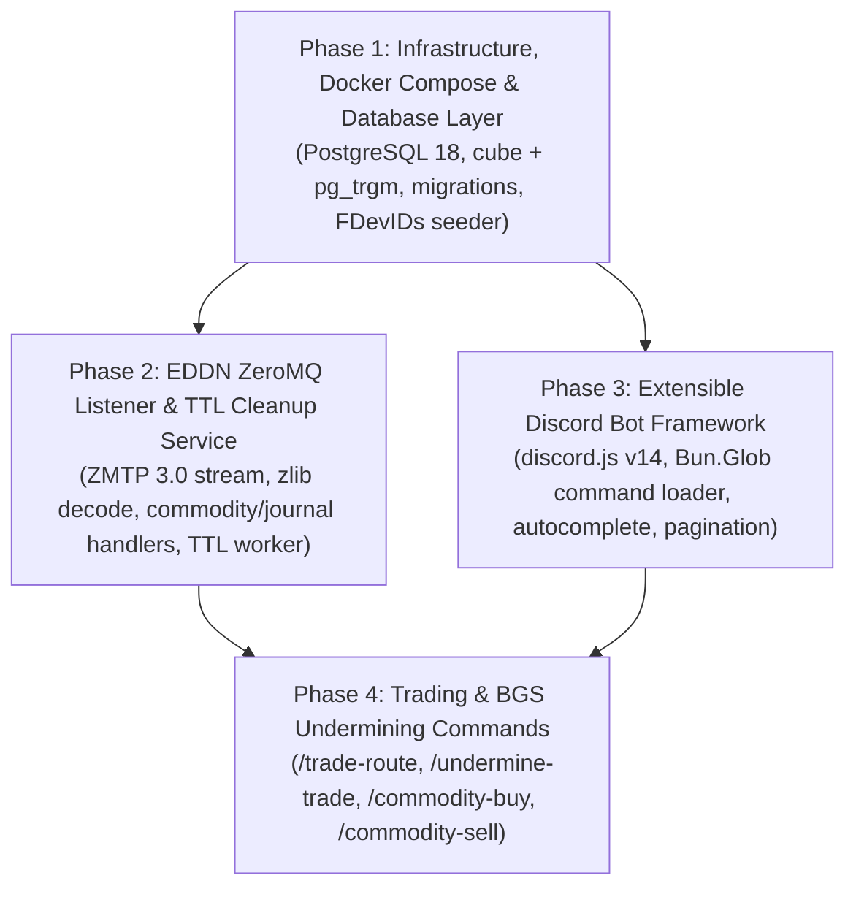

# Implementation Plan Overview

This document outlines the phased implementation roadmap for the **PPH (People's Party of Heverty) Trading Computer for Elite Dangerous**, broken into four modular phases.

---

## Target Project Structure

```text
pph-trading-computer/
├── docker-compose.yml               # Orchestrates db, listener, and bot services
├── Dockerfile                       # Shared multi-stage oven/bun:1-alpine image
├── .env.example                     # Template for environment variables
├── package.json
├── tsconfig.json
├── docs/
│   ├── README.md                    # Documentation index
│   ├── project_proposal.md          # Original project proposal
│   ├── research/
│   │   ├── 01-eddn-and-third-party-tools.md
│   │   ├── 02-database-and-ttl-strategy.md
│   │   └── 03-tech-stack-and-docker-compose.md
│   └── plan/
│       ├── overview.md
│       ├── phase-1-infrastructure-and-database.md
│       ├── phase-2-eddn-listener-and-ttl.md
│       ├── phase-3-discord-bot-framework.md
│       └── phase-4-trading-and-bgs-commands.md
├── scripts/
│   ├── migrate.ts                   # Runs SQL migrations via Bun.sql
│   ├── seed-commodities.ts          # Fetches/parses EDCD/FDevIDs commodity.csv & rare_commodity.csv
│   └── deploy-commands.ts           # Registers slash commands with Discord API
├── src/
│   ├── config/
│   │   └── env.ts                   # Typed environment & TTL configuration
│   ├── db/
│   │   ├── index.ts                 # Bun.sql instance & connection helper
│   │   ├── migrations/
│   │   │   └── 001_initial_schema.sql
│   │   └── queries/
│   │       ├── ingest.ts            # Upsert queries for systems, stations, factions, market_listings
│   │       ├── trading.ts           # Profit routes, loss/undermine routes, buy/sell price queries
│   │       ├── autocomplete.ts      # Fast trigram autocomplete queries
│   │       └── cleanup.ts           # TTL expiration queries
│   ├── listener/
│   │   ├── index.ts                 # Listener entrypoint (migrations -> seed -> ZMTP stream + TTL cron)
│   │   ├── zmtp-client.ts           # Resilient ZMTP 3.0 SUB client over Bun.connect + zlib inflate
│   │   ├── router.ts                # Filters schemas & routes commodity/3 and journal/1 events
│   │   ├── handlers/
│   │   │   ├── commodity.handler.ts # Handles commodity/3 market snapshots
│   │   │   └── journal.handler.ts   # Handles Docked, FSDJump, Location, CarrierJump
│   │   ├── normalizer.ts            # Cleans FDev $economy_...; tokens & infers pad sizes
│   │   ├── coord-resolver.ts        # Optional lazy EDSM coordinate backfill for unknown systems
│   │   └── ttl-worker.ts            # Periodic TTL cleanup task
│   └── bot/
│       ├── index.ts                 # Discord bot entrypoint
│       ├── types.ts                 # BotCommand interface & option types
│       ├── registry.ts              # Auto-discovers *.command.ts files via Bun.Glob
│       ├── autocomplete/
│       │   └── index.ts             # Reusable autocomplete handlers (system, station, commodity, faction)
│       ├── ui/
│       │   ├── embeds.ts            # Standardized PPH-themed Discord embeds & formatting helpers
│       │   └── pagination.ts        # Button-based page navigation for multi-route results
│       └── commands/
│           ├── trade/
│           │   ├── route.command.ts       # /trade-route (best profitable routes between systems/stations/radius)
│           │   ├── buy.command.ts         # /commodity-buy (cheapest buying prices & stock)
│           │   └── sell.command.ts        # /commodity-sell (most expensive selling prices & demand)
│           └── bgs/
│               ├── undermine.command.ts   # /undermine-trade (loss trade routes to hurt a faction's economy)
│               └── status.command.ts      # /db-status (database stats, EDDN ingest rate, freshness)
└── tests/
    ├── normalizer.test.ts
    ├── zmtp.test.ts
    └── queries.test.ts
```

---

## Implementation Phases



| Phase | Document | Key Deliverables |
| :--- | :--- | :--- |
| **Phase 1** | [phase-1-infrastructure-and-database.md](./phase-1-infrastructure-and-database.md) | `docker-compose.yml`, `Dockerfile`, `.env.example`, PostgreSQL schema (`001_initial_schema.sql`), `Bun.sql` client, `EDCD/FDevIDs` commodity catalog seeder |
| **Phase 2** | [phase-2-eddn-listener-and-ttl.md](./phase-2-eddn-listener-and-ttl.md) | ZMTP 3.0 listener (`tcp://eddn.edcd.io:9500`), `commodity/3` and `journal/1` (`Docked`, `FSDJump`, `Location`, `CarrierJump`) ingestion, EDSM coordinate resolver, and automated TTL cleanup worker |
| **Phase 3** | [phase-3-discord-bot-framework.md](./phase-3-discord-bot-framework.md) | `discord.js` v14 setup in Bun, dynamic file-based command registry (`Bun.Glob`), `pg_trgm` autocomplete helpers, interactive button pagination, embed builders |
| **Phase 4** | [phase-4-trading-and-bgs-commands.md](./phase-4-trading-and-bgs-commands.md) | Implementation of `/trade-route`, `/undermine-trade`, `/commodity-buy`, `/commodity-sell`, and `/db-status`, plus unit/integration tests |
