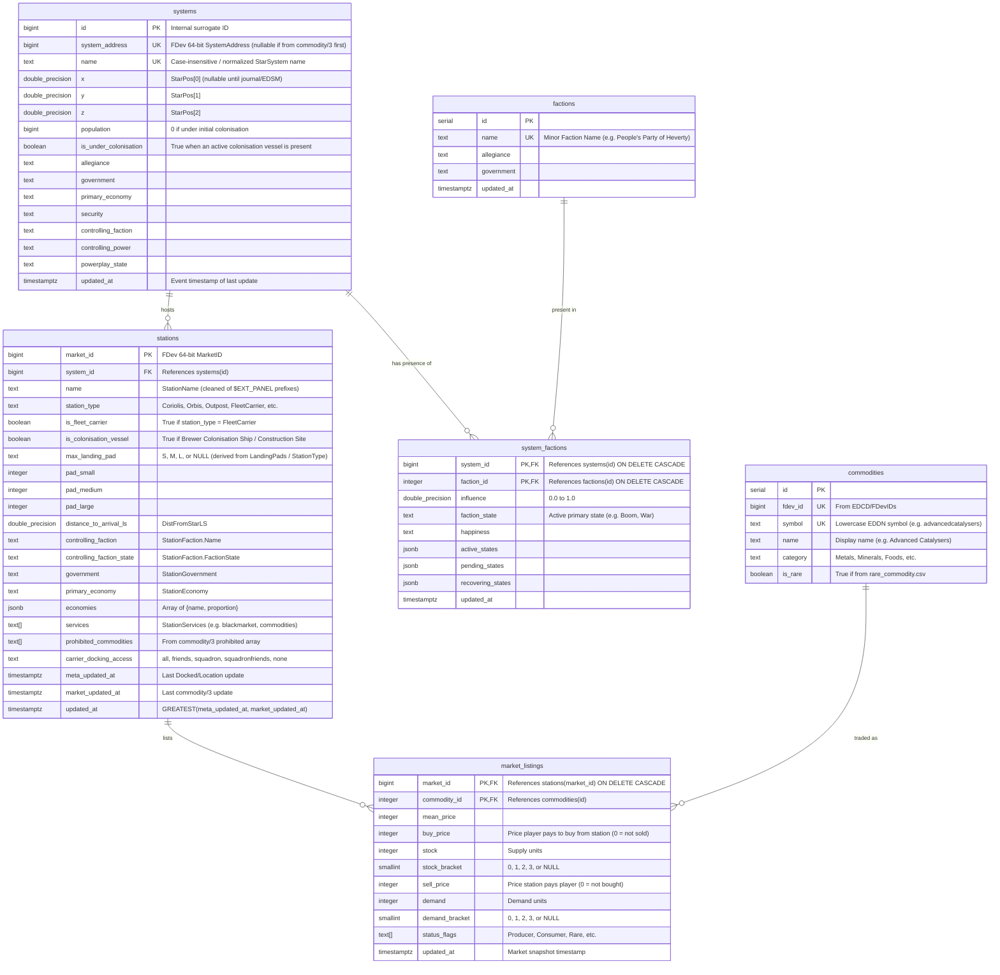

# Research: PostgreSQL Schema Design, 3D Spatial Indexing & TTL Strategy

## 1. Storage Requirements & Design Goals

Our PostgreSQL database needs to support two concurrent workloads:
1. **Write-Heavy Ingestion (EDDN Listener):** Continuous stream of `FSDJump`, `Location`, `Docked`, `CarrierJump`, and `commodity/3` events. Each `commodity/3` message contains 30–120 commodity rows for a single station (`market_id`).
2. **Read-Heavy Analytical & Spatial Queries (Discord Bot):**
   * Finding the most profitable trades (`sell_price - buy_price > 0`) between two specific systems/stations, or within a jump radius (in Light Years) of a reference system (e.g., `Heverty`).
   * Finding loss trade routes (`sell_price - buy_price < 0`) targeting a specific system, station, or controlling minor faction to undermine their economy/influence.
   * Finding the cheapest buying price (`buy_price > 0 AND stock > 0`) for a commodity across the galaxy or within $N$ Light Years of a system.
   * Finding the highest selling price (`sell_price > 0 AND demand > 0`) for a commodity across the galaxy or within $N$ Light Years of a system.
   * Fast autocomplete lookups (`ILIKE` / trigram prefix search) for system names, station names, commodity names, and faction names.

---

## 2. Relational Schema Design

### Entity-Relationship Diagram



---

## 3. Fast 3D Spatial Queries in PostgreSQL (`cube` Extension)

Star systems in Elite Dangerous are positioned in a 3D Cartesian coordinate grid `(x, y, z)` measured in Light Years with `Sol` at `(0, 0, 0)` and a precision of $\frac{1}{32}\text{ Ly}$ (`0.03125`).

Calculating `SQRT(POWER(s1.x - s2.x, 2) + POWER(s1.y - s2.y, 2) + POWER(s1.z - s2.z, 2))` across tens of thousands of systems via a full table scan is slow.

### Solution: Built-in PostgreSQL `cube` + `pg_trgm` Extensions

PostgreSQL ships with the **`cube` extension** in `contrib` (available out-of-the-box in the official `postgres:18` and `postgres:18-alpine` Docker images — no PostGIS bloat needed!).

```sql
CREATE EXTENSION IF NOT EXISTS cube;
CREATE EXTENSION IF NOT EXISTS pg_trgm;

-- Functional GiST index on 3D coordinates for systems with known coordinates
CREATE INDEX idx_systems_coords_gist
  ON systems USING gist (cube(ARRAY[x, y, z]))
  WHERE x IS NOT NULL AND y IS NOT NULL AND z IS NOT NULL;

-- Trigram indexes for instant Discord autocomplete on names
CREATE INDEX idx_systems_name_trgm ON systems USING gin (name gin_trgm_ops);
CREATE INDEX idx_stations_name_trgm ON stations USING gin (name gin_trgm_ops);
CREATE INDEX idx_commodities_name_trgm ON commodities USING gin (name gin_trgm_ops);
CREATE INDEX idx_factions_name_trgm ON factions USING gin (name gin_trgm_ops);
```

With `idx_systems_coords_gist`:
1. **3D Radius Search (All systems within $R$ Light Years of target `(x0, y0, z0)`):**
   The `cube_enlarge(cube(ARRAY[x0, y0, z0]), R, 3)` operator `@>` uses the GiST R-tree index to prune the search space to a 3D bounding cube of radius $R$, and the `<->` operator computes exact 3D Euclidean distance in C:
   ```sql
   SELECT id, name,
          cube(ARRAY[x, y, z]) <-> cube(ARRAY[$1::float8, $2::float8, $3::float8]) AS distance_ly
   FROM systems
   WHERE x IS NOT NULL
     AND cube_enlarge(cube(ARRAY[$1::float8, $2::float8, $3::float8]), $4::float8, 3) @> cube(ARRAY[x, y, z])
     AND (cube(ARRAY[x, y, z]) <-> cube(ARRAY[$1::float8, $2::float8, $3::float8])) <= $4::float8
   ORDER BY distance_ly ASC;
   ```
2. **K-Nearest Neighbors (KNN):**
   ```sql
   ORDER BY cube(ARRAY[x, y, z]) <-> cube(ARRAY[$1, $2, $3]) LIMIT 20;
   ```
   This executes in **< 2 milliseconds** even with 100,000+ populated systems.

---

## 4. Inferring Landing Pad Size When `LandingPads` is Missing

In EDDN:
* `Docked` events explicitly include `"LandingPads": {"Small": 8, "Medium": 8, "Large": 16}`.
* However, if we receive a `commodity/3` event before a `Docked` event for that station, we still have `"stationType"`.
* We can deterministically infer `max_landing_pad` from `stationType` as a fallback when `LandingPads` is not yet populated:
  * **Large (`'L'`):** `Coriolis`, `Orbis`, `Ocellus`, `Bernal`, `AsteroidBase`, `CraterPort`, `CraterOutpost`, `SurfaceStation`, `MegaShip`, `FleetCarrier`.
  * **Medium (`'M'`):** `Outpost` (all orbital outposts max out at Medium pads!).
  * **Variable (`'S'`/`'M'`/`'L'`):** `OnFootSettlement` (Odyssey settlements vary; only mark `'L'` if confirmed by `LandingPads.Large > 0`).

---

## 5. High-Throughput Upsert Strategy for `market_listings`

When a `commodity/3` message arrives for `market_id = 4314617603` with 80 commodities:
1. Check if `message.timestamp` is within the valid TTL window and not in the future.
2. Check if `stations.market_updated_at` for `market_id` is already `>= message.timestamp`. If so, **skip the entire message immediately**!
3. Within a single transaction (or single multi-CTE SQL query using `UNNEST` arrays in `Bun.sql`):
   * Upsert `systems` (by `name`).
   * Upsert `stations` (by `market_id`), setting `market_updated_at = $timestamp`.
   * Delete or replace removed listings for that `market_id` and batch-upsert all 80 rows in `market_listings` using `UNNEST($commodity_ids::int[], $mean_prices::int[], $buy_prices::int[], ...)`:
     ```sql
     INSERT INTO market_listings (
       market_id, commodity_id, mean_price, buy_price, stock, stock_bracket,
       sell_price, demand, demand_bracket, status_flags, updated_at
     )
     SELECT
       $1::bigint,
       u.commodity_id, u.mean_price, u.buy_price, u.stock, u.stock_bracket,
       u.sell_price, u.demand, u.demand_bracket, u.status_flags, $2::timestamptz
     FROM UNNEST(
       $3::int[], $4::int[], $5::int[], $6::int[], $7::smallint[],
       $8::int[], $9::int[], $10::smallint[], $11::timestamptz[]
     ) AS u(...)
     ON CONFLICT (market_id, commodity_id) DO UPDATE SET
       mean_price = EXCLUDED.mean_price,
       buy_price = EXCLUDED.buy_price,
       stock = EXCLUDED.stock,
       stock_bracket = EXCLUDED.stock_bracket,
       sell_price = EXCLUDED.sell_price,
       demand = EXCLUDED.demand,
       demand_bracket = EXCLUDED.demand_bracket,
       updated_at = EXCLUDED.updated_at
     WHERE EXCLUDED.updated_at >= market_listings.updated_at;

     -- Also remove commodities that were previously listed at this station
     -- but are no longer present in the new full market snapshot:
     DELETE FROM market_listings
     WHERE market_id = $1::bigint AND updated_at < $2::timestamptz;
     ```
   Notice that last `DELETE FROM market_listings WHERE market_id = $1 AND updated_at < $2`! Because every `commodity/3` message is a **complete snapshot** of that station's legal commodity market at timestamp `$2`, deleting any rows for that `market_id` with `updated_at < $2` automatically cleans up sold-out or delisted items (especially important for Fleet Carriers changing buy/sell orders)!

---

## 6. Time-To-Live (TTL) & Data Cleanup Strategy

As specified in the project proposal:
> *"Records must have a time to live, so that we are not storing data forever, so we need a cleanup based on that."*

### Why a Tiered TTL is Best for Elite Dangerous Data

Not all data in Elite Dangerous decays at the same speed:
1. **`commodities` Catalog:** Static reference table (~450 rows from `FDevIDs`). **Never expires.**
2. **Fleet Carrier `market_listings` (`is_fleet_carrier = true`):** Highly volatile. Carrier owners change buy/sell orders or run out of cargo space/credits within hours. Recommended TTL: **24 to 48 hours** (configurable via `TTL_FLEET_CARRIER_MARKET_HOURS`, e.g., `24h` or `48h`).
3. **Station `market_listings` (`is_fleet_carrier = false`):** BGS ticks occur once ~every 24 hours, and less-visited stations in the Bubble may only be visited by an EDDN uploader every few days. Recommended TTL: **3 to 7 days** (configurable via `TTL_STATION_MARKET_HOURS`, e.g., `72h` or `168h`).
4. **Uninhabited Systems Policy (Strict Exclusion Except Active Colonisation):**
   * **Rule:** We do **not** store uninhabited systems (`population = 0` or `NULL`) at all, **unless** the system is currently under colonisation with an active Colonisation Vessel (`is_colonisation_vessel = true`, e.g., `$EXT_PANEL_ColonisationShip; ...`, `StationGovernment = "$government_Megaconstruction;"`, or `colonisationcontribution` in `StationServices`).
   * In `FSDJump`/`Location` ingestion: if `Population == 0` (or `NULL`), the event is ignored unless the system already exists in `systems` with `is_under_colonisation = true` (in which case we only update its `x, y, z` coordinates).
   * Once a Colonisation Vessel expires (construction completes or times out without EDDN updates within the TTL window) and the system still has `population = 0`, the system is immediately purged by the TTL worker.
5. **Populated System & Station Metadata (`systems` with `population > 0`, permanent `stations`):**
   * Coordinates (`x, y, z`), landing pad sizes, and station distance (`distance_to_arrival_ls`) for populated systems are retained indefinitely and continuously refreshed by incoming `Docked`/`FSDJump`/`Location` events, while inactive Fleet Carriers and active Colonisation Vessels expire after `TTL_CARRIER_AND_COLONISATION_DAYS` (e.g., 7–14 days of no updates).

### Cleanup Mechanism Design

Rather than requiring a custom PostgreSQL image with the external `pg_cron` C extension compiled in, we run a **built-in TTL Cleanup Worker** directly inside the `listener` service (executing every 15 minutes), running batched deletes:

```sql
-- 1. Expire stale Fleet Carrier market listings (default: older than 48h)
DELETE FROM market_listings ml
USING stations s
WHERE ml.market_id = s.market_id
  AND s.is_fleet_carrier = true
  AND ml.updated_at < NOW() - ($1::int * INTERVAL '1 hour');

-- 2. Expire stale Station & Colonisation Vessel market listings (default: older than 7 days)
DELETE FROM market_listings
WHERE updated_at < NOW() - ($2::int * INTERVAL '1 hour');

-- 3. Expire inactive Fleet Carriers & finished/inactive Colonisation Vessels (default: older than 7-14 days)
DELETE FROM stations
WHERE (is_fleet_carrier = true OR is_colonisation_vessel = true)
  AND updated_at < NOW() - ($3::int * INTERVAL '1 hour');

-- 4. Purge any uninhabited system (population = 0 or NULL) that does NOT have an active Colonisation Vessel
DELETE FROM systems sys
WHERE COALESCE(sys.population, 0) = 0
  AND NOT EXISTS (
    SELECT 1 FROM stations st
    WHERE st.system_id = sys.id
      AND st.is_colonisation_vessel = true
  );

-- 5. Expire stale system_factions BGS snapshots (default: older than 14 days)
DELETE FROM system_factions
WHERE updated_at < NOW() - ($3::int * INTERVAL '1 hour');
```

### Query-Time Freshness Filtering + Age Badges
Even before the periodic cleanup job runs (every 15 minutes), all Discord bot SQL queries will include `WHERE ml.updated_at >= NOW() - ...` and display a human-readable **data age indicator** in Discord embeds (e.g., `🕒 Updated 14m ago` using Discord's native relative timestamp `<t:1729613545:R>`!).
