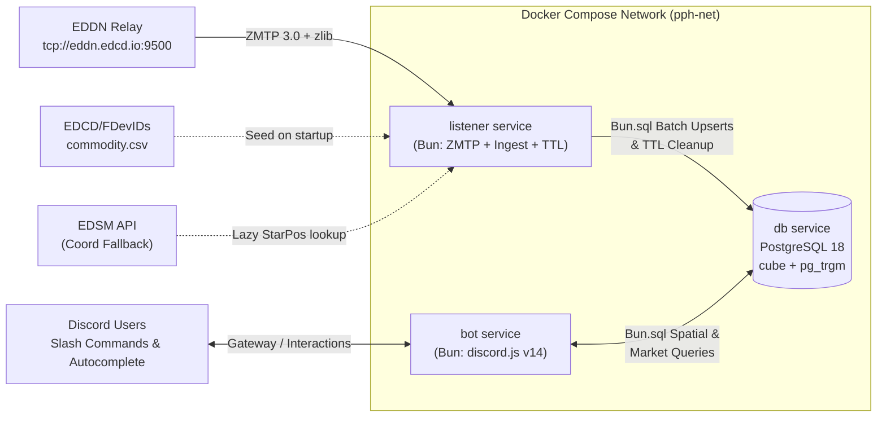

# Research: Bun Tech Stack, ZeroMQ Listener & Docker Compose Orchestration

## 1. Bun Runtime & Native APIs

Per the project's conventions ([CLAUDE.md](../../CLAUDE.md)), **Bun** (`v1.4+`) is the primary runtime for both the EDDN Listener and the Discord Bot:
* **PostgreSQL Driver (`Bun.sql`):**
  * Built directly into the Bun binary in native Zig/C.
  * Supports tagged template literals (`await sql`SELECT ...``), automatic connection pooling, prepared statements, transactions (`await sql.begin(...)`), and array/JSON serialization without external dependencies (`pg` or `postgres.js` are not needed).
  * Reads `DATABASE_URL` (or `POSTGRES_*` env vars) automatically.
* **Environment Variables:** Loaded natively by Bun from `.env` without `dotenv`.
* **Testing & Type-Checking:** `bun test` and `bun check`.

---

## 2. ZeroMQ Client in Bun: Native N-API vs. Pure-Bun ZMTP 3.0 Socket

### The Challenge with `zeromq` (npm) in Bun + Docker
The `zeromq` npm package (`v6.x`) relies on a compiled C++ Node-API (N-API) native addon (`libzmq`) with custom `libuv` async thread-safe function hooks. On Linux Docker containers (`oven/bun`), `zeromq` N-API addons have historically suffered from:
* Requiring `python3`, `build-essential`, `pkg-config`, and `libzmq3-dev` inside the container image, inflating image size by ~300 MB.
* Intermittent N-API segfaults/panics under Bun's JavaScriptCore runtime when handling high-frequency socket callbacks.

### Live Verification: Pure-Bun ZMTP 3.0 `SUB` Client (`Bun.connect`)
Because EDDN uses a single, unauthenticated **ZeroMQ `PUB` socket over TCP (`tcp://eddn.edcd.io:9500`)** speaking standard **ZMTP 3.0** (`NULL` security mechanism), the entire ZeroMQ `SUB` wire protocol consists of:
1. **64-byte Greeting Exchange:** `\xFF\x00\x00\x00\x00\x00\x00\x00\x01\x7F\x03\x00NULL` padded with zeros to 64 bytes.
2. **READY Command Frame:** `\x04\x19\x05READY\x0BSocket-Type\x00\x00\x00\x03SUB`.
3. **SUBSCRIBE Frame:** `\x04\x0A\x09SUBSCRIBE` (subscribes to empty topic `""` = all messages).
4. **Length-Prefixed Frame Stream:**
   * Byte 0 (`flags`):
     * Bit 0 (`0x01`): `MORE` flag (multipart frame).
     * Bit 1 (`0x02`): `LONG` length flag (`0` = 1-byte uint8 length following; `1` = 8-byte big-endian uint64 length following).
     * Bit 2 (`0x04`): `COMMAND` flag (e.g., ZMTP `PING`/`PONG` heartbeat frames).
   * Frame body: `zlib`-compressed bytes, decompressed via Bun's built-in `inflateSync` from `node:zlib`.

We tested this directly against `tcp://eddn.edcd.io:9500` in this workspace using `Bun.connect()` and verified that it connects, negotiates ZMTP 3.0, and decodes 15–50 live EDDN payloads per second with:
* **Zero npm dependencies**
* **Zero native C++ addons or `libzmq3-dev` apt packages**
* **Built-in automatic reconnection with exponential backoff & heartbeat timeout detection**

| Feature | Pure-Bun ZMTP 3.0 (`Bun.connect`) | `zeromq` v6 npm Package |
| :--- | :--- | :--- |
| **Dependencies** | `0` (Built-in `Bun.connect` + `node:zlib`) | Native C++ addon + `libzmq3-dev` |
| **Docker Image Size** | ~110 MB (`oven/bun:1-alpine`) | ~400+ MB (requires Debian + build toolchain) |
| **Bun Stability** | 100% native Bun TCP socket API | Prone to N-API / `libuv` panics in Bun |
| **Heartbeat / Reconnect Control** | Full control over idle watchdog & ZMTP `PING`/`PONG` | Hidden inside `libzmq` C++ background thread |

> [!TIP]
> **Recommendation:** Use a clean, well-tested ~100-line TypeScript `ZmtpSubClient` module built on `Bun.connect()` (or keep `zeromq` as an optional interface implementation behind the same `EddnStream` abstraction).

---

## 3. Extensible Discord Bot Architecture (Bun + `discord.js` v14)

The proposal highlights:
> *"This bot needs to be structured in a way that it makes it easier to include new commands"*

### Recommended Pattern: File-Based Command Registry & Plugin Pattern

By structuring `src/bot/commands/` so that every file exports a typed `BotCommand` object conforming to a single interface, adding a new command requires **only creating a single file** in `src/bot/commands/<category>/<command-name>.ts` — no central switch statement or manual registration list needed.

```ts
// src/bot/types.ts
import type {
  AutocompleteInteraction,
  ChatInputCommandInteraction,
  SlashCommandBuilder,
  SlashCommandOptionsOnlyBuilder,
  SlashCommandSubcommandsOnlyBuilder,
} from "discord.js";

export interface BotCommand {
  data:
    | SlashCommandBuilder
    | SlashCommandOptionsOnlyBuilder
    | SlashCommandSubcommandsOnlyBuilder;
  execute: (interaction: ChatInputCommandInteraction) => Promise<void>;
  autocomplete?: (interaction: AutocompleteInteraction) => Promise<void>;
  cooldownSeconds?: number;
}
```

### Auto-Discovery Loader (`Bun.Glob`)
Using Bun's built-in `Bun.Glob`, the bot automatically scans `src/bot/commands/**/*.ts` at startup (and during `bun run deploy-commands`):
```ts
const glob = new Bun.Glob("**/*.command.ts");
for await (const file of glob.scan(`${import.meta.dir}/commands`)) {
  const mod = await import(`./commands/${file}`);
  const command: BotCommand = mod.default;
  client.commands.set(command.data.name, command);
}
```

### Shared Autocomplete Utilities
Nearly every Elite Dangerous trading command needs autocomplete for:
* **System Name** (e.g., typing `Hever` $\rightarrow$ `Heverty`)
* **Station Name** (e.g., typing `Woodroffe` $\rightarrow$ `Woodroffe Gateway (Heverty)`)
* **Commodity Name** (e.g., typing `Agronomic` $\rightarrow$ `Agronomic Treatment`)
* **Faction Name** (e.g., typing `People's Party` $\rightarrow$ `People's Party of Heverty`)

We can provide reusable autocomplete helpers in `src/bot/autocomplete/` backed by PostgreSQL `pg_trgm` indexes (`LIMIT 25`, <5ms response time) that any new command can plug in with one line of code:
```ts
autocomplete: createAutocomplete({
  system: autocompleteSystem,
  source_system: autocompleteSystem,
  target_system: autocompleteSystem,
  commodity: autocompleteCommodity,
  faction: autocompleteFaction,
})
```

---

## 4. Docker Compose Orchestration Research

We have three runtime components to orchestrate via `docker-compose.yml` over an internal Docker bridge network (`pph-net`), without exposing PostgreSQL to the host/local network:
1. **`db` (`postgres:18-alpine`)**:
   * Uses the latest stable PostgreSQL 18 image (`postgres:18-alpine`).
   * Persistent named volume `pgdata:/var/lib/postgresql` (per PostgreSQL 18+ Docker convention where `PGDATA` defaults to `/var/lib/postgresql/18/docker`).
   * No `ports:` mapping so the database is isolated to the internal `pph-net` container network.
   * Tuned `shared_buffers`, `work_mem`, and `synchronous_commit=off` (optional for high-speed EDDN ingestion where losing 1 second of market cache on hard power loss is completely harmless and boosts write IOPS by 5x).
   * Healthcheck via `pg_isready -U ${POSTGRES_USER} -d ${POSTGRES_DB}`.
2. **`listener` (Bun EDDN Listener & TTL Worker)**:
   * Built from the project's `Dockerfile` (`oven/bun:1-alpine`), entrypoint `bun run src/listener/index.ts`.
   * `depends_on: db: condition: service_healthy`.
   * Runs database migrations and `FDevIDs` commodity seeding on startup before connecting to `tcp://eddn.edcd.io:9500`.
   * Runs the periodic TTL cleanup loop in the background.
3. **`bot` (Bun Discord Bot)**:
   * Built from the **same** `Dockerfile` (single shared codebase image!), entrypoint `bun run src/bot/index.ts`.
   * `depends_on: db: condition: service_healthy`.
   * Connects to Discord Gateway and queries `db` via `Bun.sql`.

### Architecture Diagram


